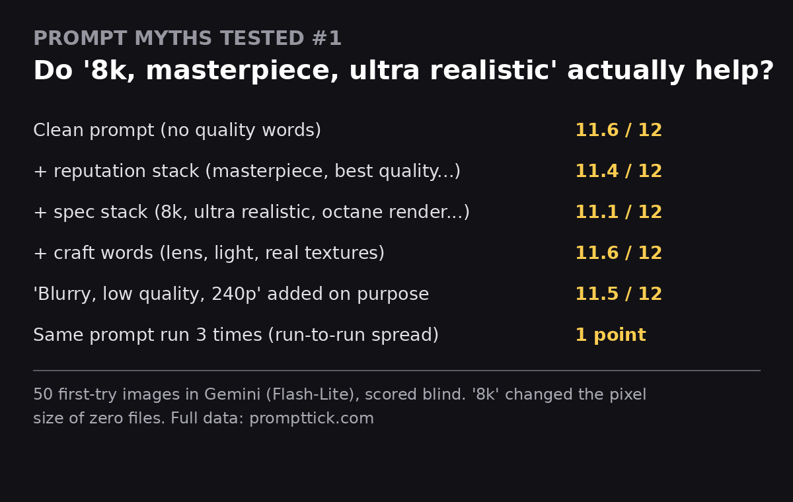

# Do "8k, Ultra Realistic, Masterpiece" Actually Help? — A 50-Image Test

**Dataset and results from a PromptTick research test (November 2026): 50 first-try Gemini images, scored blind. The famous quality words did not beat plain prompts — and "8k" changed the dimensions of zero files.**

Full write-up: [Do "8k, Ultra Realistic, Masterpiece" Actually Help? 50 First-Try Gemini Images, Scored Blind](https://prompttick.com/prompt-myths-tested-quality-words/)

## Headline results

- **Clean prompts and myth-word stacks tied.** Mean scores of 12: clean **11.57**, craft wording **11.57**, reputation stack ("masterpiece, best quality…") **11.43**, spec stack ("8k, ultra realistic…") **11.14**. Every gap is inside the test's own noise (one prompt run three times scored 12, 12, 11).
- **"8k" changed the pixel dimensions of 0 of 50 files.** Every landscape image came out 2816×1536, with or without "8k" in the prompt.
- The stacks are **not inert**: they raised measured sharpness (script-measured Laplacian) by **+58–61%** — but their realism scores were the two lowest, and **all style drift came from stacked versions** (3 images: a cabin interior turned render-like, a book cover slid to illustration twice).
- **Negative myth words were ignored:** prompts ending in "blurry, low quality, worst quality, 240p" scored **12 and 11**.
- **Contradiction test = the lowest score of the test (9):** "ultra realistic, 8k, oil painting" produced a full oil painting. The style word beat the quality words.
- Every single myth word tested alone (8k, masterpiece, ultra detailed, ultra realistic, sharp focus, trending on artstation, plus two real craft phrases) scored **12/12** on an easy skin close-up — the words change the render, not the score.

## How the test was run

- **Model:** Gemini app, "Flash-Lite" as shown in the mode picker, on a Pro account.
- **First try only.** Every image was the first generation of a brand-new chat. No re-rolls.
- **7 scenes** (café portrait, skin close-up, burger, rainy NYC street, fox in snow, cabin interior, book cover), each in 4 versions: **A** clean base, **B1** reputation stack, **B2** spec stack, **C** scene-specific craft wording.
- **Plus 22 control cells:** one-word ablations, myth words with almost no scene, repeats, Midjourney syntax, empty filler words ("lovely, pleasant, nice…"), opposite words, dose tests ("masterpiece" ×5 and ×20), a contradiction prompt, and the stack placed at the start of the prompt.
- **Scoring:** blind — images were shuffled and renamed before scoring; the key was opened only after all 50 were scored. Score of 12 = scene elements present (0–4) + lack of artifacts (0–4) + texture (0–2) + realism (0–2), plus a style label (photo / in-between / illustration) and script-measured sharpness, edge density and saturation.

## Data

[`full-results.csv`](full-results.csv) — all 50 rows: test ID, group, scene, suffix used, the four score parts, total, style label, file dimensions, and the three script measurements.

## Honest limits

- The rubric mostly checks that the prompt's contents appeared and nothing broke — not which of two images a person would pick as "better". A pairwise preference round is the follow-up this test needs.
- Each version of each scene ran once; gaps of 1–3 points are noise, not rankings.
- Scoring was done by **one AI scorer**, disclosed here and in the article.
- The app does not say which image model served each generation; we report the mode-picker label exactly as shown.

## Cite this test

> PromptTick (2026). *Do "8k, Ultra Realistic, Masterpiece" Actually Help? 50 First-Try Gemini Images, Scored Blind.* https://prompttick.com/prompt-myths-tested-quality-words/

## Licence

Data (CSV): CC BY 4.0 — use it freely, credit PromptTick with a link. Text of this README: same.

*PromptTick is a free library of copy-paste AI image prompts: https://prompttick.com*
